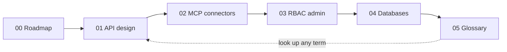

<div align="center">


<br />

**Small, runnable lessons for the backend behind AI applications.**
One concept. One runnable file. One exercise. Fifteen minutes.

<br />

[](https://opensource.org/licenses/MIT)
[](https://github.com/axomiyaindie/agentic-backend-cookbook/actions/workflows/check-python.yml)
[](https://github.com/axomiyaindie/agentic-backend-cookbook/actions/workflows/check-typescript.yml)
[](CONTRIBUTING.md)

[Start here](00-roadmap/README.md) &nbsp;|&nbsp; [Lessons](#the-lessons) &nbsp;|&nbsp; [Verify it yourself](#verify-it-yourself) &nbsp;|&nbsp; [Contribute](#contribute) &nbsp;|&nbsp; [Glossary](05-glossary/README.md)

</div>

---

## In 30 seconds

AI assistants can now generate 200 lines of backend code in a few seconds. Understanding those 200 lines still takes you hours.

This repo closes that gap. Every lesson is a tiny, **executable** example of one backend concept, so you can see what "good" looks like before you ship something you did not write.

```text
read the README  ->  run the example  ->  break it on purpose  ->  understand what broke
```

---

## What you will learn

| Question | Lesson |
|---|---|
| How does an HTTP request become a typed function call? | [`01-api-design`](01-api-design/) |
| How do CRUD operations map to verbs and status codes? | [`01-api-design`](01-api-design/) |
| How do MCP tool servers let AI clients discover and call tools? | [`02-mcp-connectors`](02-mcp-connectors/) |
| How does a server decide who is allowed to do what? | [`03-rbac-admin`](03-rbac-admin/) |
| Which database should I pick, and why? | [`04-databases`](04-databases/) |
| What does that word actually mean? | [`05-glossary`](05-glossary/) |

By the end you will be able to read AI-generated backend code and tell, with confidence, whether it is sound or quietly broken.

---

## Why this exists

The backend behind AI applications is the most requested and least explained layer in modern software. Most resources fall into two buckets:

- **Tutorials** walk you step by step, but you only ever build *their* app.
- **Documentation** is accurate, but assumes you already know what to search for.

Neither helps at the moment that matters: an AI hands you a pile of backend code and asks you to trust it.

This repo is the missing middle. It exists to **make backend concepts legible by making them executable.**

> Success condition: a reader can read a lesson, run it, break it, and understand what they broke.
> If a lesson cannot be finished in 15 minutes, it is too big for this repo.

---

## What to expect

**You can count on:**

- **Every lesson runs.** No "trust me, this works."
- **Every lesson has a README** that explains what it does and why.
- **Every lesson has an exercise** so you do more than read.
- **Every lesson maps to other languages** (Go, Rust, PHP, Ruby, Java, C#).
- **CI checks that the code compiles** on every push.
- **Executed output** is shown in the RBAC and MCP lessons.

**Do not expect:**

- **Production code.** No hardening, no migrations, no test suites.
- **Authentication.** Only authorization (RBAC). No passwords, no OAuth.
- **A full app.** No frontend, no deployment, no Docker.
- **Coverage of everything.** This is backend basics, not the whole backend.
- **Performance or scale.** Examples are correct, not tuned.
- **CI for databases.** Those lessons need live databases and are marked as not CI-tested.

If you want a production template, this is the wrong repo. If you want to **understand** what a production template does, you are in the right place.

---

## Who this is for

| This repo is for you if | This repo is not for you if |
|---|---|
| You vibe-code with AI and want to understand the output | You want a copy-paste SaaS starter |
| You are learning backend and want small wins | You need a production deployment guide |
| You teach a class, bootcamp, or study group | You want framework comparisons |
| You review AI-generated PRs and need a mental baseline | You are looking for frontend tutorials |

---

## Learning path



Start at **[`00-roadmap/README.md`](00-roadmap/README.md)**. It tells you which lesson to read first and why, and doubles as a safety net: if an AI generates backend code you do not understand, the roadmap points you to the lesson that explains it.

---

## The lessons

Click any folder or file to open it on GitHub.

### [`00-roadmap/`](00-roadmap/) - Start here

Suggested reading order, plus a "vibe coding" safety net.

| File | What it is |
|---|---|
| [`00-roadmap/README.md`](00-roadmap/README.md) | Reading order and safety net |

### [`01-api-design/`](01-api-design/) - HTTP, typed requests, CRUD

How a request becomes a typed function, and how Create / Read / Update / Delete map to HTTP verbs. No server needed. Both examples run with `npx tsx`.

| File | What it is |
|---|---|
| [`01-api-design/README.md`](01-api-design/README.md) | Section overview and language policy |
| [`01-api-design/01-http-typescript/README.md`](01-api-design/01-http-typescript/README.md) | Describing a request and response as a type |
| [`01-api-design/01-http-typescript/example.ts`](01-api-design/01-http-typescript/example.ts) | Typed request/response with no server, just functions |
| [`01-api-design/02-crud-model/README.md`](01-api-design/02-crud-model/README.md) | How CRUD maps to HTTP verbs and status codes |
| [`01-api-design/02-crud-model/example.ts`](01-api-design/02-crud-model/example.ts) | In-memory CRUD: create, read, update, delete |

### [`02-mcp-connectors/`](02-mcp-connectors/) - MCP tool servers

**MCP** (Model Context Protocol) is how AI clients discover and call tools. The example is a single-file server exposing one tool: the whole protocol surface in 65 lines.

| File | What it is |
|---|---|
| [`02-mcp-connectors/README.md`](02-mcp-connectors/README.md) | What MCP is, and where real servers live |
| [`02-mcp-connectors/01-minimal-mcp-server/README.md`](02-mcp-connectors/01-minimal-mcp-server/README.md) | Walkthrough of the smallest possible MCP server |
| [`02-mcp-connectors/01-minimal-mcp-server/server.ts`](02-mcp-connectors/01-minimal-mcp-server/server.ts) | `tools/list` and `tools/call`: the whole protocol |
| [`02-mcp-connectors/01-minimal-mcp-server/package.json`](02-mcp-connectors/01-minimal-mcp-server/package.json) | `tsx` and `typescript` |

**Verified output:**

```text
tools/list -> [ { name: "add_numbers", inputSchema: {...}, ... } ]
tools/call add_numbers({a:2,b:3}) -> { sum: 5 }
```

### [`03-rbac-admin/`](03-rbac-admin/) - Role-based access control

How the server knows *this* user is allowed to do *that*. Demonstrates 200 (allowed), 403 (denied), and 401 (not logged in).

| File | What it is |
|---|---|
| [`03-rbac-admin/README.md`](03-rbac-admin/README.md) | What RBAC is, plus an "admin panel" note |
| [`03-rbac-admin/01-fastapi-rbac/README.md`](03-rbac-admin/01-fastapi-rbac/README.md) | Step-by-step walkthrough with expected results |
| [`03-rbac-admin/01-fastapi-rbac/main.py`](03-rbac-admin/01-fastapi-rbac/main.py) | `login` -> `get_current_role` -> `require_role("admin")` |
| [`03-rbac-admin/01-fastapi-rbac/requirements.txt`](03-rbac-admin/01-fastapi-rbac/requirements.txt) | `fastapi` and `uvicorn` |

**Verified output (executed):**

```text
admin -> GET /admin/users  -> 200 OK
user  -> GET /admin/users  -> 403 {"detail":"insufficient role"}   <- the point
none  -> GET /me           -> 401 {"detail":"missing token"}
```

### [`04-databases/`](04-databases/) - Four engines, one CRUD

The same four operations in Postgres, MySQL, MongoDB, and DynamoDB. Read them side by side to see what changes and what does not.

| File | What it is |
|---|---|
| [`04-databases/README.md`](04-databases/README.md) | Why four engines, not one |
| [`04-databases/01-database-comparison.md`](04-databases/01-database-comparison.md) | Decision table, and what an AI assistant is likely to pick |
| [`04-databases/02-postgres-crud/README.md`](04-databases/02-postgres-crud/README.md) | Postgres setup and parameterised queries |
| [`04-databases/02-postgres-crud/schema.sql`](04-databases/02-postgres-crud/schema.sql) | The `users` table with constraints |
| [`04-databases/02-postgres-crud/crud.py`](04-databases/02-postgres-crud/crud.py) | Postgres CRUD with `RETURNING` |
| [`04-databases/03-mysql-crud/README.md`](04-databases/03-mysql-crud/README.md) | MySQL setup and the `lastrowid` difference |
| [`04-databases/03-mysql-crud/crud.py`](04-databases/03-mysql-crud/crud.py) | MySQL CRUD with `lastrowid` |
| [`04-databases/04-mongodb-crud/README.md`](04-databases/04-mongodb-crud/README.md) | MongoDB setup and the no-schema trade-off |
| [`04-databases/04-mongodb-crud/crud.py`](04-databases/04-mongodb-crud/crud.py) | MongoDB CRUD with `ObjectId` and `$set` |
| [`04-databases/05-dynamodb-crud/README.md`](04-databases/05-dynamodb-crud/README.md) | DynamoDB setup and access-pattern-first design |
| [`04-databases/05-dynamodb-crud/crud.py`](04-databases/05-dynamodb-crud/crud.py) | DynamoDB CRUD with `UpdateExpression` |

**Requires a live database.** Not run in CI. The comparison doc tells you which to pick.

### [`05-glossary/`](05-glossary/) - Every term, defined

Plain-English definitions of every term used in this repo: API, CRUD, RBAC, JWT, MCP, partition key, SQL injection, parameterised query, and more. If a lesson uses a word you do not know, it is here.

| File | What it is |
|---|---|
| [`05-glossary/README.md`](05-glossary/README.md) | A to Z of terms in the cookbook |

---

## Verify it yourself

The fastest proof that the repo works: run the **RBAC lesson** and watch the 403 appear.

```bash
cd 03-rbac-admin/01-fastapi-rbac
pip install -r requirements.txt
uvicorn main:app --reload
```

In a second terminal:

```bash
# Admin -> 200 OK
curl -s -X POST http://127.0.0.1:8000/login \
  -H "Content-Type: application/json" \
  -d '{"username":"admin","password":"admin"}'

curl -s http://127.0.0.1:8000/admin/users \
  -H "Authorization: Bearer token-admin"

# User -> 403 Forbidden  <- this is the point
curl -s -X POST http://127.0.0.1:8000/login \
  -H "Content-Type: application/json" \
  -d '{"username":"user","password":"user"}'

curl -s http://127.0.0.1:8000/admin/users \
  -H "Authorization: Bearer token-user"
```

**200 for admin. 403 for user. That is the whole guarantee.**

The MCP lesson needs no external services:

```bash
cd 02-mcp-connectors/01-minimal-mcp-server
npm install
npx tsx server.ts
# prints the tools/list schema and { sum: 5 }
```

---

## What you can do with this repo

Free to use for all of these (MIT license):

- **Learn:** read a lesson, run it, break it.
- **Teach:** use it in a class, bootcamp, or study group.
- **Audit:** before accepting AI-generated backend code, check what it should look like.
- **Fork:** strip it down and add your own lessons.
- **Translate:** port a lesson to your language (see the "In another language?" table in each lesson README).
- **Contribute:** see below.
- **Star:** the only signal that tells other learners it is worth their time.

**Not for:** copying into production, using as a starter template, or deploying without hardening.

---

## Contribute

See **[`CONTRIBUTING.md`](CONTRIBUTING.md)** for the full recipe format. The short version:

1. **One idea per lesson.** If the README needs "and also...", split it.
2. **Runnable code.** One or two files, with an exercise at the bottom.
3. **README with required sections:** what you will learn, how to run, what to look at, in another language.
4. **No secrets.** No `.env`, API keys, or tokens in examples.

**Good next lessons:**

- Rate limiting and backpressure
- Background jobs and queues
- File uploads and storage
- WebSockets and streaming
- Observability (logs, metrics, traces)

**Bad candidates:** frontend topics, cloud deployment walkthroughs, framework comparisons. This is a backend cookbook, not a general tutorial site.

PRs welcome. Small PRs preferred. One commit per file or per lesson, no "fix typo" noise.

---

## Repo files at the root

| File | What it is |
|---|---|
| [`README.md`](README.md) | This file |
| [`assets/logo.svg`](assets/logo.svg) | Banner and logo |
| [`LICENSE`](LICENSE) | MIT: free to use, fork, teach with |
| [`CONTRIBUTING.md`](CONTRIBUTING.md) | Recipe format for new lessons |
| [`.gitignore`](.gitignore) | What not to commit |
| [`.github/workflows/check-python.yml`](.github/workflows/check-python.yml) | CI: byte-compiles every `.py` |
| [`.github/workflows/check-typescript.yml`](.github/workflows/check-typescript.yml) | CI: type-checks every `.ts` lesson |

---

## Stack

| Layer | Language / tool | Why |
|---|---|---|
| API and MCP lessons | **TypeScript / Node** | Types show the concept and are easy to skim |
| RBAC lesson | **Python / FastAPI** | Cleanest role-check pattern |
| Databases | **Postgres, MySQL, MongoDB, DynamoDB** | Same CRUD, four engines |

**These languages are examples, not requirements.** Each lesson has an "In another language?" table showing Go, Rust, PHP, Ruby, Java, and C# equivalents.

---

## CI: what is tested on every push

| Check | What it does |
|---|---|
| **Check Python** | `python -m py_compile` on every `.py` file, catching syntax errors |
| **Check TypeScript** | `tsc --noEmit` on each lesson, catching type errors |

These are **compile checks**, not behavioral tests. They catch rot as the repo is edited; they do not replace running the examples yourself. The database lessons are **not tested in CI** because that would need four live databases.

---

<div align="center">

**If this saved you time, star the repo.**
It is the only signal that tells other learners the examples are worth their time.

MIT License. See [`LICENSE`](LICENSE). Use it, fork it, teach with it.

</div>
